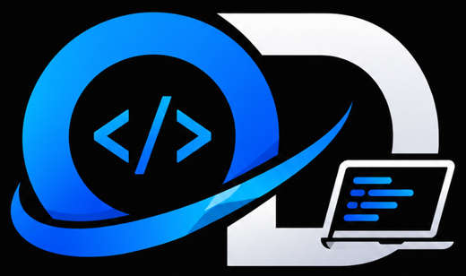

<p align="center"></p>
<p align="center"><b>Projet réalisé par Ousmane Dev</b></p>

# Karat Livreur — application des livreurs (Android et iPhone)

Application Capacitor qui ouvre l'espace livreur de Karat Logistique
(`https://karat-logistique.netlify.app/livreur/coursier`) et partage la position
du livreur **même téléphone verrouillé** pendant son service (service de premier
plan avec la notification « Karat Livreur — suivi actif »,
plugin `@capacitor-community/background-geolocation`). La position est envoyée par
le réseau natif (`CapacitorHttp`) avec un jeton (`/api/livreur/courier/device-token`).

## Construire l'APK

Prérequis : Node 18+, JDK 17+, Android SDK (platform 35, build-tools 35).

```sh
npm install
npx cap sync android
cd android
KARAT_KEYSTORE=/chemin/karat-livreur.keystore KARAT_KEYSTORE_PASSWORD=... ./gradlew assembleRelease
```

L'APK signé se trouve dans `android/app/build/outputs/apk/release/app-release.apk`.
Copiez-le dans `public/livreur/app/karat-livreur.apk` pour le publier sur le site.

La clé de signature n'est **pas** dans le dépôt (public) : le propriétaire de
Karat Logistique la conserve (archive `karat-livreur-cle.zip` : keystore, mot de
passe, alias `karat`). Toutes les mises à jour doivent être signées avec cette
même clé, sinon Android refuse de les installer par-dessus.
Pensez à augmenter `versionCode` dans `android/app/build.gradle` à chaque version.

## iPhone (iOS)

Le projet Xcode est dans `ios/` (Swift Package Manager, iOS 14+). Il se construit
uniquement sur un Mac avec Xcode. Le workflow GitHub `iOS Karat Livreur` vérifie
qu'il compile à chaque modification (simulateur, sans signature).

Pour l'installer sur les iPhone des livreurs :

1. Créer un compte Apple Developer (99 $ par an) au nom de Karat Logistique.
2. Sur un Mac : `npm install && npx cap sync ios && npx cap open ios`, choisir
   l'équipe (Team) dans Signing & Capabilities, puis Product › Archive.
3. Envoyer l'archive sur App Store Connect et inviter les livreurs dans
   **TestFlight** (ou publier sur l'App Store).

Le suivi écran verrouillé utilise le mode d'arrière-plan « location »
(`UIBackgroundModes`) ; iOS affiche l'indicateur bleu de localisation.
